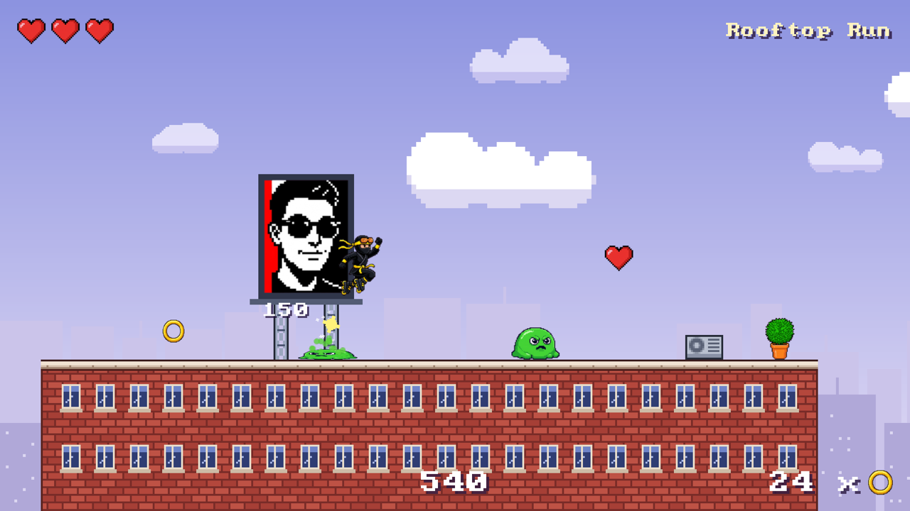
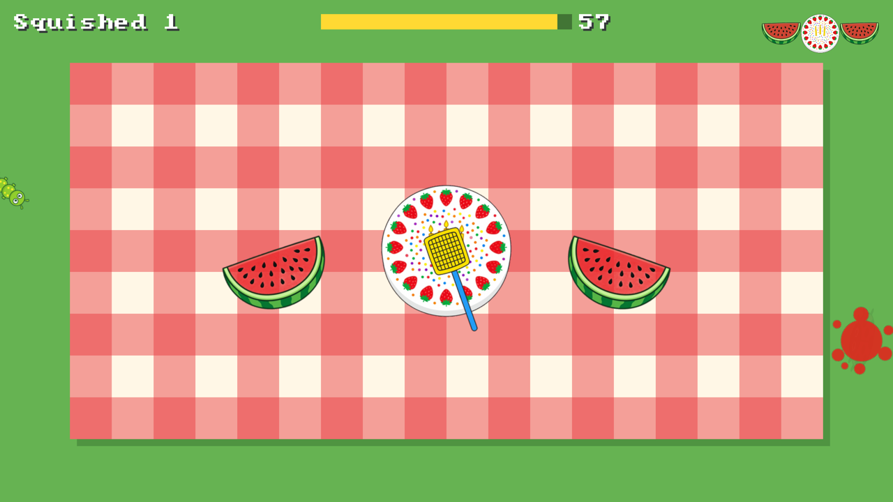
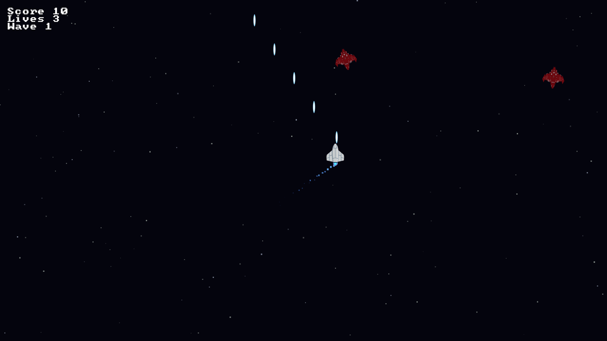

# klyph

**Make games in Kotlin.** klyph is a small, fast 2D game engine. Your game compiles to a native
program for Windows, macOS and Linux, with no JVM and nothing extra to install.

[](https://central.sonatype.com/artifact/com.eventslooped.klyph/klyph)
[](https://github.com/inemtsev/klyph/actions/workflows/ci.yml)
[](LICENSE)

| [Rooftop Roller](games/roller) | [Bug Squish](games/squish) | [Shooter](games/shooter) |
|---|---|---|
|  |  |  |

## Your first window

```kotlin
import klyph.app.AppConfig
import klyph.app.Phase
import klyph.app.runApp
import klyph.platform.Scancode

fun main() {
    runApp(AppConfig(title = "My game", width = 1280, height = 720)) {
        addSystem(Phase.INPUT) { app ->
            if (app.input.keyboard.isJustPressed(Scancode.ESCAPE)) app.quit()
        }
    }
}
```

The whole build file is three lines:

```kotlin
plugins { id("com.eventslooped.klyph") version "1.0.0" }
klyph { entryPoint = "mygame.main" }
kotlin { sourceSets.nativeMain.dependencies { implementation("com.eventslooped.klyph:klyph:1.0.0") } }
```

`./gradlew run` plays it. `./gradlew distribute` zips it with SDL3 for your players. The
quickest start is [klyph-template](https://github.com/inemtsev/klyph-template): press "Use this
template" and you have a window, a ship that flies, and CI on three desktops.

## Learn

- **[The Quest](https://klyph.eventslooped.com/)**: build a real game in 11 short steps, with Kip,
  a little block with a sprout on top, as your guide. Start here if you are new to game making.
- **[The guide](https://inemtsev.github.io/klyph/guide/index.html)**: one page per topic, from
  sprites to shipping, with every snippet compiled.
- **[API reference](https://inemtsev.github.io/klyph/)**: every public declaration, with samples
  that run as tests.
- **[Three sample games](games/)**: a top-down shooter, a bug-squishing game for small children
  and a platformer. Each plays itself with `-Pklyph.autopilot=1`.

## What you get

- **Entities, components, systems and scenes.** Plain data, plain functions, a fixed timestep,
  and a scene stack where a pushed scene freezes the one below.
- **Sprites in one draw call.** Sprite sheets, animation, a camera, text, particles, and a
  debug overlay on F3.
- **Input.** Keyboard, mouse and gamepads.
- **Audio.** WAV and Ogg Vorbis effects with pitch and pan, streamed music with fades, mixed on
  SDL's audio thread. Games run quietly without a device, so CI is happy.
- **Collisions.** Boxes and circles with layers and masks, reported as events, plus shape queries.
- **Movement.** A velocity the engine applies each fixed step, and kinematic bodies that walk,
  jump and land on solids and one-way ledges, with sweeps for what lies ahead.
- **A Gradle plugin** that finds or downloads SDL3, runs your game and packages it.

## Fast and stable

On an Apple M4 Pro, 100,000 moving sprites draw in 2.5 ms a frame and 100,000 particles in
2.4 ms, through the full game loop. [BENCHMARKS.md](BENCHMARKS.md) has the numbers and the
method.

klyph 1.0 is out, and code you write for it keeps working in every 1.x release. The one
exception is the SDL and GPU plumbing marked `@KlyphPlatformApi`, which a game never needs.
Changes are listed in [CHANGELOG.md](CHANGELOG.md).

## How it works

- **Kotlin/Native from top to bottom.** One language from your game to the SDL calls.
- **SDL3 and SDL_GPU.** Windows, input and audio from SDL; one GPU API compiled ahead of time to
  Metal, Vulkan and Direct3D 12. [prior-art.md](prior-art.md) has the survey behind the choice.
- **Vertex pulling.** Sprites are records in a storage buffer and the vertex shader builds each
  quad, so a frame is one buffer write and one draw.
- **An API shaped like the standard library.** [API_STYLE.md](API_STYLE.md) is the rule book:
  a Kotlin developer can guess a call before looking it up.

## Contributing

Issues and pull requests are welcome. [CONTRIBUTING.md](CONTRIBUTING.md) covers building the
repository, the tests, the samples and the benchmarks, and the ideas for what comes after 1.0
are the issues labelled [post-1.0](https://github.com/inemtsev/klyph/issues?q=label%3Apost-1.0).

[Apache License 2.0](LICENSE).
