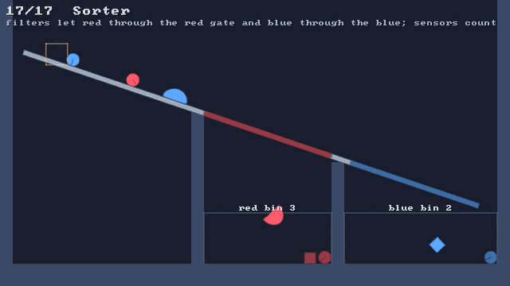

# 🚦 Filters, sensors and events

⚡ **Say who collides with whom, put down zones that only notice, and hear when things touch.**



## 🧠 How it works

- 👉 everything is on some **layers**, what it is, and has a **mask**, what it collides with: two things collide only if each one's mask holds a layer of the other 🎭
- 👉 a **sensor** never pushes or is pushed: it only notices what's in it 👀
- 👉 **events** say what began and stopped touching, what came into and left a sensor, and which joints broke 📣

<details>
<summary>🤓 the details</summary>

```kotlin
val RED = CollisionLayers.of(1)
val RED_GATE = CollisionLayers.of(3)
val notRedGate = CollisionLayers(CollisionLayers.ALL.bits and RED_GATE.bits.inv())

world.rigidBodies.setLayers(gate, RED_GATE, CollisionLayers.ALL)
world.rigidBodies.setLayers(ball, RED, notRedGate)   // passes the red gate
world.softBodies.setLayers(blob, RED, notRedGate)
world.particles.setLayers(grain, RED, CollisionLayers.ALL)
world.particles.setSolidCollision(grain, SolidCollision.PASS)   // falls through the level

world.rigidBodies.setResponse(zone, ContactResponse.SENSE)

world.step(dt)
val e = world.events
for (i in 0 until e.sensorsEntered.size) e.sensorsEntered[i].a   // the sensor
for (i in 0 until e.contactsBegun.size) {
    val touch = e.contactsBegun[i]
    touch.a.kind; touch.a.toRigidBody()        // TouchKind.RIGID_BODY, a handle
    touch.b.kind; touch.b == TouchSide.SOLIDS  // or SOFT_BODY, PARTICLE, SOLIDS
}
e.contactsBegun.has(TouchSide.of(ball), TouchSide.SOLIDS)   // did the ball land?
for (i in 0 until e.brokenJointCount) e.brokenJointAt(i)
```

**Filters.** Layers are klyph's `CollisionLayers`: a thing's layers and mask can use any of the 32.
Physics collides a pair only when `layersA and maskB != 0 && layersB and maskA != 0`, so each one
can refuse the other; a klyph `Collider` is looser, and `app.collisions` reports a pair when either
mask holds a layer of the other. Everything starts on `CollisionLayers.DEFAULT` with the mask
`CollisionLayers.ALL`. The level has no layer, so no mask touches it: to let a thing fall through the
floor, call `setSolidCollision(thing, SolidCollision.PASS)`. A wall that stops only some layers is a
static rigid body on a layer, not the level. A soft body's filter is
all its particles'. Every place two things meet asks: rigid against rigid, against particles and soft
bodies, soft against soft, particles against the solids, and a bullet's sweep. A filtered pair never
gets a contact, so it never pushes, never wakes the other and never joins its island.

**Sensors.** A rigid body made a sensor still goes in the broadphase. Every substep, wherever it
meets something its filter lets in, it checks for an overlap and writes it down, and pushes nothing.
It notices rigid bodies, soft bodies and loose particles, but not the solids or other sensors, and
raycasts pass through it. It's checked even against bodies that are asleep, so nothing leaves a
sensor by falling asleep in it.

**Touches.** Each step, every pair that touched is written into a little hash set, however many
substeps and contact points it had: rigid bodies, soft bodies and the level, in any pair. At the end
of the step it's compared with last step's set. What's new has **begun**, what's gone has **ended**,
so each comes once. A pair touches if it pushed, or is within a quarter of a unit. Without that
slop, two boxes standing side by side would touch and stop touching every few steps.

**Sleeping touches.** A sleeping body isn't looked at, so its contacts aren't found. A pair where
everything is asleep or static is carried over from the step before, so a stack falling asleep ends
nothing. A body that's removed ends its touches in the next step.

**Joints.** A weld that pulls harder than its `breakForce` breaks, is removed, and goes in
`brokenJointCount` and `brokenJointAt`.

</details>

## 🎛️ The knobs

| knob | default | what it does |
|---|---|---|
| `setLayers(handle, layers, mask)` | `CollisionLayers.DEFAULT`, `CollisionLayers.ALL` | on rigid bodies, soft bodies and particles: who collides with whom |
| `setSolidCollision(handle, SolidCollision.PASS)` | `SolidCollision.COLLIDE` | it passes through the level |
| `setResponse(body, ContactResponse.SENSE)` | `ContactResponse.PUSH` | notices, never pushes |
| `breakForce` on a weld | never | how hard it can be pulled before it breaks, and says so |

## 💥 Gotchas

- 💥 **Two boxes side by side touched and stopped touching every few steps.** Resting against each
  other, they push now and then, not every substep. A pair within a quarter of a unit counts as
  touching now, push or not.
- 💥 **The test crate slid off the blob.** The events said so, begin and then end, and they were
  right: the test had the crate on a dome. It's on a flat cushion now.
- 💥 **A ball's touch began half a ball off the floor.** It hit and bounced back up within one step,
  so by the step's end it was in the air. Events say what happened in the step, not where things are
  at its end.
- 💥 **Loose particles don't get contact events.** Sand would flood them. They have their own
  readouts, `isOnFloor` and `isTouching`, and sensors do notice them.
- 💥 **A sensor in a dynamic body falls through the floor.** It doesn't touch the solids. Make it
  static, or kinematic to carry it about.
- 💥 **The tests were checked by breaking things.** Taking out the rigid filter, carrying over
  sleeping touches, or the slop each made them fail.

## 🧪 Try it

`./gradlew :games:physics:run`, press `→` until **Sorter** ([`SorterScene.kt`](../../games/physics/src/nativeMain/kotlin/klyph/physics/demo/SorterScene.kt)).
The red part of the ramp is on a layer red things leave out of their masks, the blue part the
same for blue. Each bin's count comes from its sensor's events, and every flash is a touch that
began. Right click to drop more. 🚦
